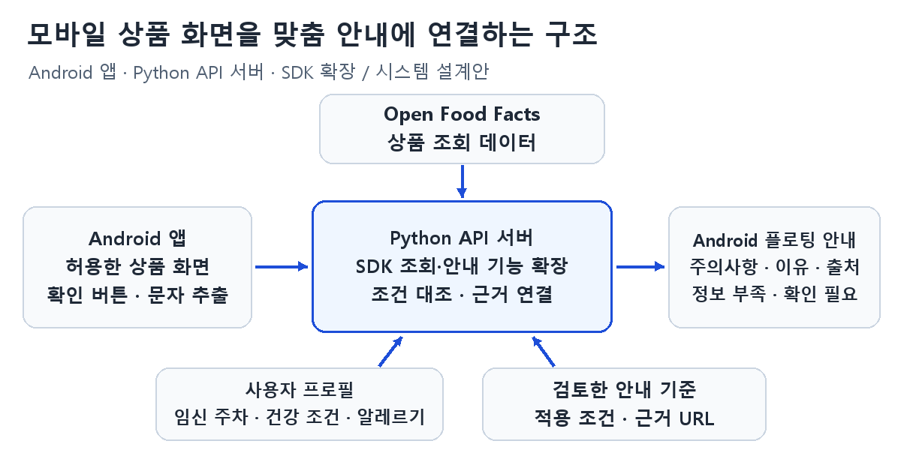

# 도담도담 — Android 모바일 식품 확인 프로젝트 제안

임산부가 스마트폰의 쇼핑 앱에서 자신에게 해당하는 식품 주의사항을 확인하도록 돕는 프로젝트를 제안한다. 상품 화면이나 링크를 다른 AI 앱으로 옮기고 질문하는 수고를 줄이는 것이 목표다.

현재는 **개별 프로젝트 제안 단계**다. 초기 시제품은 Android 앱으로 설계하며, 실행 가능한 구현 코드와 검증 결과는 아직 없다.

## 제안서와 자료

- [제안서 본문](proposal.md)
- [Android 시스템 개요](02_시스템개요_Android.png)
- [모바일 캡처 배치·설명 초안](mobile_capture_note.md)

대표 그림에는 사용자가 직접 캡처한 모바일 쇼핑 앱의 상품 상세 화면을 추가할 예정이다. 사진의 공통 구성은 실제 캡처를 확인한 뒤 서술한다.

## 분석·개선 대상

[Open Food Facts Python SDK](https://github.com/openfoodfacts/openfoodfacts-python)를 분석·개선 대상으로 삼는다. 원본 SDK는 상품 조회·검색 기능을 제공한다. 본 제안은 이 조회 결과에 사용자 조건별 주의사항, 적용 이유, 출처와 정보 누락 상태를 연결하는 기능을 추가한다.

| 구분 | 원본의 기능 | 추가할 기능 |
| --- | --- | --- |
| 상품 확인 | 상품 조회·검색 | 모바일 화면에서 읽은 상품과 조회 후보의 일치 여부 확인 |
| 반환 정보 | 상품의 식품 정보 | 사용자에게 해당하는 안내와 적용 이유 |
| 설명 근거 | 조회된 상품 정보 | 안내 기준별 출처 연결 |
| 정보 누락 | 호출 측에서 조회 결과를 해석 | 누락 항목과 추가로 확인할 조건 표시 |

위 표는 개선 계획이다. 원본을 fork한 뒤 조회 함수와 반환 구조를 확인하고 변경할 위치를 정한다.

## 모바일 이용 흐름

1. 사용자가 도담도담을 실행하고 화면 접근·플로팅 표시를 허용한다.
2. 쇼핑 앱에서 궁금한 상품의 상세 화면을 연다.
3. 플로팅 확인 버튼을 눌러 현재 상품 정보를 읽는다.
4. 같은 화면 위의 하단 안내 패널에서 주의사항·적용 이유·출처와 추가 확인 조건을 읽는다.
5. 패널을 닫고 쇼핑을 이어간다. 사용자가 확인 세션을 종료할 수 있도록 한다.

임신 주차·건강상태·알레르기는 근거가 있는 안내에만 반영한다. 상품을 식별하지 못하거나 정보가 부족하면 확인 필요 상태를 표시한다.

## 시스템 구성

Android 앱에서 사용자가 허용한 상품 화면의 정보를 추출하고, Python API 서버를 통해 SDK 조회·안내 기능을 실행한다. 결과는 모바일 쇼핑 화면 위의 플로팅 안내로 반환한다. AI는 정보 구조화와 채택된 근거에 따른 설명 정리에 활용한다.

## 개발·검증 계획

1. SDK를 fork하고 조회·검색 코드, 반환 구조와 라이선스를 확인한다.
2. Android의 화면 접근·플로팅 표시가 대상 쇼핑 앱에서 가능한지 먼저 검증한다.
3. 상품명·브랜드·규격을 추출하고 조회 후보와 대조한다. 원재료·영양 정보의 제공 여부도 확인한다.
4. 사용자 조건과 검토한 안내 기준을 연결하고, 출처와 누락 항목을 반환하는 기능을 추가한다.
5. API 서버와 플로팅 버튼·하단 안내 패널을 연결한다.
6. 예시 상품 10~15개와 가상 프로필로 정보 누락·상품 오인·권한 거부·지원하지 않는 조건을 검증한다.
7. 원본 조회 결과와 확장 결과를 비교한다. 별도 AI 앱 방식과 시제품의 화면 전환·입력 횟수 및 확인 시간도 비교한다.

초기 범위는 Android와 쇼핑 앱 한 곳이다. 구체적인 앱과 AI 도구는 화면 접근·상품 데이터 확인 후 정한다. 팀 주제로 선정되면 4명이 원본 코드·서버, 안내 기준·기능, Android 화면 연동, 검증·문서화를 나누고 서로의 변경을 리뷰한다.

## 라이선스와 자료 이용

원본 Python SDK의 MIT 라이선스 고지를 유지한다. 식품 데이터는 코드와 별도로 Open Food Facts의 ODbL 및 해당 자료의 재사용 조건을 확인한다. 현재 자료에는 원본 코드나 식품 데이터 사본을 포함하지 않았다.

- [원본 SDK와 라이선스](https://github.com/openfoodfacts/openfoodfacts-python)
- [식품 API와 데이터 이용 안내](https://openfoodfacts.github.io/openfoodfacts-server/api/)
- [Android 화면 접근](https://developer.android.com/media/grow/media-projection)
- [Android 플로팅 표시](https://developer.android.com/reference/android/view/WindowManager.LayoutParams#TYPE_APPLICATION_OVERLAY)
- 전체 출처는 [제안서](proposal.md#7-출처)에 정리했다.
