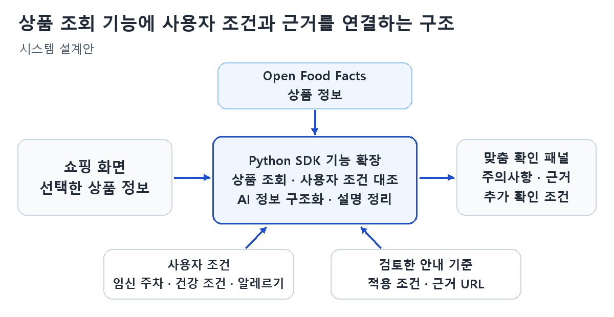

# 도담도담 프로젝트 제안서

## 1. 주제

Open Food Facts SDK 확장을 통한 임산부 맞춤형 식품 확인 서비스 도담도담

분반: [분반]  /  팀: [팀 번호]  /  학번: [학번]  /  이름: 김이안

## 2. 요약

도담도담은 임산부가 온라인으로 식품을 구매할 때 자신에게 해당하는 주의사항과 확인할 조건을 쇼핑 화면에서 살펴보도록 돕는 서비스다. Open Food Facts Python SDK의 상품 조회 기능을 분석하고, 임신 주차·건강상태·알레르기와 식품 정보를 대조해 관련 안내와 출처를 제공하는 기능을 추가한다. 상품 정보를 읽고 설명을 정리하는 데 AI를 활용하며, 안내는 검토한 근거를 바탕으로 제공한다. 이를 통해 다른 앱으로 이동해 자료를 첨부하고 질문을 반복하는 수고를 줄이고자 한다.

## 3. 대표 그림

그림 1. 쇼핑 화면에서 상품을 선택하고 맞춤 주의사항과 근거를 확인하는 예상 화면

## 6. 결론

본 프로젝트는 오픈소스 식품 조회 기능에 사용자 조건별 안내와 출처 표시 기능을 추가하는 설계안이다. 향후 원본 코드와 라이선스를 분석하고, 안내 기준과 시제품을 작성한 뒤 정보 누락 처리와 확인 과정의 개선 여부를 검증한다.

## 4. 서론

### 배경 설명 및 사례 분석

임신 중에는 식품의 종류뿐 아니라 성분, 조리 방법과 개인 조건에 따라 확인할 정보가 달라질 수 있다. 공식 식품 안내에서도 주의할 식품과 조리 조건을 구분하며, 임신 초기의 영양 안내와 임신성 당뇨에 관한 식품 안내를 별도로 제공한다[3][4][5]. 온라인 쇼핑 중 이러한 정보를 확인하려고 상품 URL이나 화면 캡처를 다른 앱으로 옮겨 질문하는 경우, 상품을 고르는 흐름이 끊길 수 있다.

분석 대상인 Open Food Facts Python SDK는 상품 정보를 조회하고 검색하는 기능을 제공하는 오픈소스다[1]. 식품 API를 통해 원재료와 영양 정보를 얻을 수 있지만[2], 이를 구매 중인 상품과 연결하고 개인에게 해당하는 안내 근거를 제시하는 과정은 추가 설계가 필요하다. 본 프로젝트는 원본의 상품 조회 구조와 반환 데이터를 분석하고 이 연결 과정을 개선한다.

### 문제 정의

상품 정보와 개인별 주의사항이 따로 제공되면 사용자가 둘을 직접 대조해야 한다. 같은 상품이라도 알레르기가 있는 사용자는 특정 성분을, 임신성 당뇨가 있다고 등록한 사용자는 탄수화물 정보를 먼저 확인할 수 있다[5][6]. 또한 상품 식별이 불확실하거나 정보가 빠져 있으면 충분한 근거 없이 안내를 만들기 어렵다. 따라서 사용자의 조건에 해당하는 정보와 근거를 함께 보여주고, 부족한 정보도 구분하는 기능이 필요하다.

### 극복 방안

원본 SDK의 상품 조회 기능을 바탕으로 사용자 조건과 검토한 안내 기준을 대조하는 기능을 추가한다. 임신 주차는 적용 주차의 근거가 있는 안내에 사용하고, 건강상태와 알레르기도 해당 기준에 따라 반영한다. 결과에는 주의사항, 적용 이유, 출처와 추가로 확인할 조건을 포함한다. 초기 시제품은 PC 쇼핑 화면 한 곳과 확인 가능한 예시 상품을 대상으로 구성한다. 구매 후 식재료 관리, 레시피 추천과 일일 영양 리포트는 향후 확장으로 남긴다.

## 5. 본론

### 시스템 개요

그림 2. 상품 조회 기능에 사용자 조건과 근거를 연결하는 구조. SDK 확장 기능은 Python API 서버에서 실행한다.

### 필요한 기술 요소

- Open Food Facts Python SDK: 원본의 조회·검색 코드와 반환 데이터, 라이선스를 분석하고 상품과 프로필을 받아 안내를 반환하는 기능을 추가한다.
- 사용자 조건 및 안내 기준: 임신 주차 범위, 건강 조건, 확인할 성분·영양 항목과 근거 URL을 기준표로 관리한다.
- AI: 상품 정보를 구조화하고, 조회 결과와 채택된 근거를 읽기 쉬운 설명으로 정리한다. 안내 기준을 새로 만드는 역할은 맡기지 않는다.
- 브라우저 확장 프로그램: 상품 확인 버튼과 결과 패널을 쇼핑 페이지 안에 표시한다[7]. 상품이 정확히 식별되지 않으면 사용자 확인을 거친다.
- Python API 서버: 확장 프로그램의 요청을 받아 SDK 확장 기능을 실행하고 결과를 반환한다. SDK와 쇼핑 화면을 연결하는 역할을 한다.
- Ubuntu와 Git/GitHub: Python 모듈의 실행·검증 환경을 구성하고, 이슈·브랜치·Pull Request로 변경 내용과 리뷰를 관리한다.

### 구현 방법 및 개발 방향

1. 원본 SDK를 fork해 팀 저장소와 개발 환경을 구성하고, 조회 함수와 반환 구조를 분석한다. 코드의 MIT 라이선스와 식품 데이터의 ODbL 재사용 조건을 구분해 확인하고 원본 고지를 유지한다[1][2].
2. 상품명만으로 자동 확정하지 않고 브랜드·규격·성분을 대조한다. 조회 정보와 사용자 조건을 받아 안내와 출처를 반환하는 SDK 기능을 추가하고, 정보가 없거나 대조가 불확실하면 확인 필요 상태로 처리한다.
3. Python API 서버를 통해 쇼핑 화면의 확인 버튼과 결과 패널을 연결한다. 안내 기준과 정보 구조가 안정된 뒤 AI의 정보 추출·설명 기능을 연동한다.
4. 예시 상품 10~15개와 서로 다른 예시 프로필을 사용해 안내 항목과 출처가 적절히 연결되는지 확인한다. 정보 누락·상품 오인·지원하지 않는 건강 조건도 검증한다.

4명은 원본 코드·데이터 분석, 안내 기능, 화면 연동, 검증·문서화를 나누고 서로의 변경을 리뷰한다. 역할은 팀 주제 선정 후 조정한다. 원본의 상품 조회 결과와 확장된 안내 결과를 비교해 추가한 기능을 확인하고, 별도 앱을 거치는 방식과 시제품의 화면 전환·입력 횟수 및 확인 시간을 비교한다. 설치 방법, 원본과의 차이, 적용 범위와 출처를 README에 기록한다.

## 7. 출처

[1] Open Food Facts, “Open Food Facts Python SDK,”
https://github.com/openfoodfacts/openfoodfacts-python

[2] Open Food Facts, “Introduction to Open Food Facts API documentation,”
https://openfoodfacts.github.io/openfoodfacts-server/api/

[3] NHS, “Foods to avoid in pregnancy,”
https://www.nhs.uk/pregnancy/keeping-well/foods-to-avoid/

[4] NHS, “Pregnancy vitamins and supplements,”
https://www.nhs.uk/pregnancy/keeping-well/pregnancy-vitamins-and-supplements/

[5] University Hospitals Sussex NHS Foundation Trust, “Healthy eating with gestational diabetes,”
https://www.uhsussex.nhs.uk/resources/healthy-eating-with-gestational-diabetes/

[6] U.S. Food and Drug Administration, “Food Allergies,”
https://www.fda.gov/food/nutrition-food-labeling-and-critical-foods/food-allergies

[7] Google, “Content scripts — Chrome Extensions,”
https://developer.chrome.com/docs/extensions/develop/concepts/content-scripts

웹 자료 확인일: 2026년 10월 13일.

[1]: https://github.com/openfoodfacts/openfoodfacts-python
[2]: https://openfoodfacts.github.io/openfoodfacts-server/api/
[3]: https://www.nhs.uk/pregnancy/keeping-well/foods-to-avoid/
[4]: https://www.nhs.uk/pregnancy/keeping-well/pregnancy-vitamins-and-supplements/
[5]: https://www.uhsussex.nhs.uk/resources/healthy-eating-with-gestational-diabetes/
[6]: https://www.fda.gov/food/nutrition-food-labeling-and-critical-foods/food-allergies
[7]: https://developer.chrome.com/docs/extensions/develop/concepts/content-scripts
